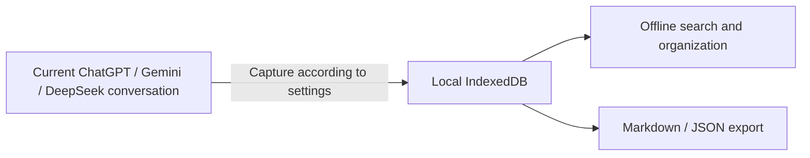

# AI Chat Memory

**Local ChatGPT, Gemini & DeepSeek conversation backup · Offline search · Markdown / JSON export**

[简体中文](README.md) | **English**

[Install the extension](#installation) · [Quick start](#quick-start) · [Platform support](#platform-support) · [Privacy policy](PRIVACY.md)

AI Chat Memory (`ai-chat-memory`) is a Chrome / Chromium extension that saves the ChatGPT, Gemini,
and DeepSeek chats you are currently browsing, so you can find them offline, organize them, and export
them as Markdown or JSON. Search and read saved conversations in a separate manager; records live
in the current browser profile's IndexedDB.

Everyday use requires no API key, Node.js, or local server. The project operates no backend,
telemetry, or cloud synchronization. An optional shared directory requires your explicit authorization.

> Automatic saving is enabled by default, but **first-time automatic collection requires reliable
> evidence that the conversation is natively pinned**. You can manually capture unpinned conversations.
> The extension does not enumerate or bulk-download your account's remote conversation history.
> Ordinary automatic updates depend on rendered content. For long ChatGPT / Gemini conversations,
> use manual complete capture and check the result.



## Features

- **Archive conversations from three platforms**: save user prompts and assistant answers,
  with separate automatic-save controls for each platform.
- **Current-conversation sidebar**: view capture status, update a record, mark it important,
  and control image/file permissions. The draggable launcher starts at `top: 70px; right: 10px`,
  hides while the sidebar is open, and returns when it closes. The sidebar can be resized and locked.
- **Independent manager**: search offline and filter by platform, account, environment,
  importance, and time; inspect, export, or delete saved records.
- **Capture options**: ChatGPT offers DOM and network capture for current and share pages.
  Gemini also offers DOM and network capture for both current and share pages.
- **Local attachment copies**: copy readable conversation images, authorize ordinary files
  per conversation, and supplement missing files from your computer. Saved text attachments have an offline preview.
- **Export and backup**: export a conversation or selected messages as Markdown, export
  environments as Markdown ZIP files, and back up conversation data and saved attachments as JSON.
- **Optional shared directory**: explicitly authorize the same local directory in several
  Chromium browser profiles on one machine to view their archives.

## Platform support

| Capability | ChatGPT | Gemini | DeepSeek |
| --- | --- | --- | --- |
| Current-conversation DOM capture and incremental updates | Supported | Supported | Supported |
| Native pin detection for first-time automatic collection | Supported | Supported | No reliable native evidence yet |
| Manual scrolling to read a complete conversation | Supported | Supported | Uses current-page capture |
| Capture from a manually supplied share link | Supported | Supported (DOM / network) | Not integrated |
| Explicit network capture | Supported | Supported | Not integrated |
| Manage and export saved records | Supported | Supported | Supported |

With pinned-only collection enabled, DeepSeek conversations need a manual first save.
Already-saved conversations can still receive automatic updates when that platform is enabled.
Attachment support depends on the resources actually rendered and readable on the page;
not every attachment can be copied.

## Installation

Requires Chrome / Chromium 118 or later. Dedicated validation of the declared Chrome 118 minimum
and compatibility across different computers has not been completed.

| What you have | Next step |
| --- | --- |
| A built `ai-chat-memory-<version>.zip` | Follow "Use an existing package" below; no Node.js required |
| Source downloaded from GitHub or a Git clone | Follow "Build from source" below to create `dist/`; requires Node.js 22 and npm |

GitHub's **Code → Download ZIP** downloads source code, which cannot be loaded directly as a built extension package.

### Use an existing package

If you have `ai-chat-memory-<version>.zip`:

1. Extract it into a permanent directory containing `manifest.json` directly.
2. Open `chrome://extensions` and enable **Developer mode**.
3. Choose **Load unpacked** and select that directory.
4. Open or refresh a supported AI conversation page.

The ZIP contains extension files at its root, without an extra `dist/` directory.

### Build from source

Building requires Node.js 22 and npm. From the project root:

```bash
npm ci
npm run typecheck
npm run lint
npm run build
```

Load the resulting `dist/` directory as an unpacked extension. The build also creates
`ai-chat-memory-<version>.zip` at the project root; the version comes from `package.json`.

**After updating, reload the extension and refresh any already-open AI tabs.** Existing content
scripts are not replaced automatically. Capture pauses and asks you to refresh when versions do not match.

## Quick start

1. Open a ChatGPT, Gemini, or DeepSeek conversation and wait for its content to appear.
2. Click the AI Chat Memory launcher at the edge of the page to open the sidebar.
3. Start capture manually, or let automatic saving collect a conversation that meets the native pin conditions.
4. Check the sidebar for the result. Click the extension toolbar icon to open the full manager.
5. Search, filter, mark important, or export your saved conversations.

Settings control global and per-platform automatic saving, pinned-only first collection,
attachment permissions, and the shared directory. An important mark is local classification:
it is independent of native pinning and does not grant attachment permissions.
The current extension interface is primarily in Simplified Chinese.

### Automatic updates and manual capture

Ordinary automatic updates read the current page's rendered conversation, wait for it to stabilize,
and save it without actively scrolling or refreshing the page. A virtualized list may mount only
part of the conversation. A saved record does not mean that your whole account history has been backed up.

Manual complete DOM capture in ChatGPT and Gemini scrolls through the current conversation,
reads additional rendered windows, and checks continuity. Successful capture leaves the page at the verified top.
Content with unverified identity or completeness is not presented as a complete result.
Finish Gemini response generation or editing before starting complete DOM capture.

### ChatGPT / Gemini share-page capture

1. Manually create or update a **whole-conversation** share on ChatGPT or Gemini itself.
2. Return to the original conversation's extension sidebar, choose share-page mode, paste the link, and start capture.
3. The extension opens one task-owned tab, reads the share, verifies its relationship to the original conversation,
   and supplements that original record.
4. If background rendering pauses, use **打开分享页 ↗** to bring the capture tab forward,
   keep it visible, then return to the original sidebar for the result.

The extension does not create shares for you. The respective website determines who can access a share link;
use current-page capture for content you do not want to share. An old share may lack recent messages:
update it manually on ChatGPT before using it to complete a record.

### ChatGPT / Gemini network capture

Gemini offers four sidebar choices: current-page DOM, share-page DOM, current-page network, and share-page network.
Share network capture accepts a manually pasted Google short link or full share URL. Short links
are expanded only when starting a task, without login credentials. Share-page DOM uses no debugger and does not refresh the source. It verifies scroll boundaries, consecutive question/answer slots and unique source text anchors, preserving existing text, attachments and originating account.
Gemini history must pass native parent/selected-answer checks, the oldest-history boundary, and
rendered prose/code comparisons. Unknown display components stop saving. Hidden render comments
and suggestion-button action parameters are omitted, and private response fields never supply
message times. Failed Gemini verification preserves existing records; retry or use current-page DOM.
Gemini does not offer the exceptional candidate-confirmation workflow.
The original page must render the share's final question/answer pair to bind its branch;
if it cannot, update the whole-conversation share and retry.

Network capture requires explicit selection and startup; ordinary automatic updates always use the DOM.
It reads responses naturally returned by the exact target page and does not call or replay private conversation APIs.

Current-page network capture performs one controlled refresh after checking for unsent drafts,
selected or uploading attachments, editing, and generation. Finish editing and generation first.
Opening DevTools or another debugger can interrupt capture.

Messages are saved as verified only after message identity, pagination or branch evidence,
and rendered anchors pass checks. If an interrupted ChatGPT task offers a safely identity-bound candidate,
you may explicitly confirm retention from the originating sidebar. It is marked **待补全 / pending completion**,
not a complete backup. Confirmation preserves existing text and attachments and copies no new attachments.
Only a later complete capture that actually covers the pending messages clears the marker.

## Images, files, and backups

Image saving is enabled by default and can be overridden per conversation. Ordinary files require
separate permission. After granting permission, capture again to supplement readable attachments.
Disabling permission stops subsequent reads without deleting an existing local copy.

- Choose a per-attachment limit of 1 / 2 / 5 / 10 MB; the hard ceiling is 10 MB.
- Decoded attachments total at most 30 MB per conversation.
- Filename-only, inaccessible, oversized, or unauthorized resources retain metadata and status.
- Saved `.txt`, `.md`, and `.markdown` files support offline previews. Display is limited to 200,000 characters;
  copying and downloading still use the complete content.
- For an ordinary file without a saved copy, use **从本地补齐** in the manager and select the same-named original file.

| Purpose | Format | Contents |
| --- | --- | --- |
| Read or share a conversation or message selection | Markdown | Text, attachment names and status; no attachment binaries |
| Read a batch of archived conversations | Markdown ZIP | One Markdown file per conversation, grouped by environment; no attachment binaries |
| Back up and restore conversations | Version-1 JSON | Accounts, conversations, importance, pending-completion state, and saved attachment data |

Markdown preserves saved message order without generating an AI summary. JSON backs up conversation data,
**not the entire browser environment**: it excludes display settings, automatic-save exclusions,
directory authorization, and local share-link preferences.

Deleting a local record last confirmed as pinned also excludes it from automatic saving so it is not
immediately recollected. An unpinned record is deleted without exclusion. Remove exclusions in Settings,
or restore a conversation through manual saving or JSON import.

## Privacy and permissions

See the complete [bilingual Privacy Policy](PRIVACY.md). The manager's Settings page also links
to an offline copy included in the extension.

### Where data lives

Conversation text, attachments, account labels, and settings live in the current Chrome profile's
IndexedDB database, `AIChatMemoryDB`. Profiles are isolated. Saved lists, search, details, and copied
attachments work offline; remote attachments without a local copy still need to be supplemented when readable.

The extension does not upload conversations, searches, logs, or analytics. It writes data outside the
browser profile only when you explicitly export or authorize a shared directory. Exported JSON and
shared-directory files have no additional encryption; choose a trusted location and decide independently
whether to place them in a third-party synchronization folder.

It does not read authentication cookies, tokens, or credential stores, scan other remote conversations,
automatically click host controls, or inject remote code. Account labels may come from displayed names;
ChatGPT separates accounts only when its profile control exposes one unambiguous email, using a normalized hash;
Gemini may also use a displayed email address. These remain local: redact them in bug reports.

### Why these permissions exist

| Permission or page scope | Purpose |
| --- | --- |
| Content scripts on the three supported websites | Read the current rendered conversation and display the launcher/sidebar |
| `debugger` | Read naturally returned responses bound to an explicitly started ChatGPT or Gemini network capture or probe |
| Google / OpenAI image hosts | Read bounded rendered image resources to create local copies |
| Gemini public-share hosts | Expand only a manually supplied short share link, without login credentials |
| A directory manually chosen through the system picker | Optional local mirrors between browser environments |

Image hosts are `lh3.googleusercontent.com`, `lh3.google.com`, `*.oaiusercontent.com`, and
`images.openai.com`. Within attachment permissions and size limits, the extension can also read
ordinary-file download URLs already supplied by the conversation page. See the
[manifest](public/manifest.json) and [architecture](ARCHITECTURE.md).

### Optional shared directory

In each browser environment, explicitly choose and authorize the same local directory and give the
environment a recognizable name. The manager initially shows only the current environment;
select others explicitly with the display-environment control.

```text
AIChatMemory/
  ai-chat-memory.json
  environments/
    env-<UUID>/
      environment.json
      accounts.json
      conversations/
        <conversation-id>.json
```

IndexedDB remains the primary local store. Directory failures do not undo successful local saves.
The browser may ask you to authorize again after restarting. This is a same-machine directory mirror,
not a cloud synchronization service provided by the extension.

Deleting another environment's shared record writes a deletion request. The source environment
applies the local deletion and removes saved attachments when it next runs with directory write access
using version 0.5.35 or later. Clearing the current environment retains its identity and directory
connection and mirrors its empty state. Back up important records as JSON first.

## Limitations and troubleshooting

| Situation | Explanation or action |
| --- | --- |
| No first automatic save | Check global/platform switches, pinned-only collection, and exclusions; try manual capture |
| A long conversation contains only some messages | Automatic capture depends on rendered windows; try manual complete capture in ChatGPT / Gemini |
| Share capture is waiting | Open the task-owned share tab and keep it visible; do not create a separate capture tab |
| Network capture stops | Check drafts, attachments, and generation; close conflicting DevTools and start again |
| An attachment has a name but no downloadable copy | Check permissions, accessibility, and limits; recapture or supplement an ordinary file locally |
| Version mismatch after updating | Reload the extension, then refresh already-open AI tabs |
| ChatGPT shows a name but is still grouped as an unidentified account | Names are display labels only. A separate group requires one unambiguous email from the profile control. Without that evidence, storage retains `unknown` and does not infer ownership from names; separate browser profiles provide isolation |
| A message has no time | Only genuine source times are kept; capture, import, and synchronization times are not substituted |

ChatGPT currently exposes minute-precision assistant reply times after you manually open that reply's
native More-actions menu. User prompt times, dates written inside Gemini answers, and private response
timestamp fields are not inferred to be message timestamps.

Historical ChatGPT `unknown` records are not automatically assigned to the current login; recapturing after
identification may create a separate copy. Existing text, attachments, importance, permissions and manual labels
are retained. The unidentified group does not take the current display name, and temporary loss of identity
evidence does not move an identified record into that group.

Website layouts and rendering change. Complete archiving cannot be guaranteed for every renderer,
interactive component, branch, or attachment. Identity or completeness failures remain failed or pending,
rather than being presented as complete. This is an independent project with no official affiliation
with OpenAI, Google, or DeepSeek.

## Development and verification

```bash
npm run typecheck
npm run lint
npm run build
```

The full build creates the UI, content script, and background Service Worker, verifies them in
`.dist-build/`, then publishes `dist/` and a versioned ZIP. Checks cover site extraction, pins,
conversation-window merging, completeness, attachments, exports, shared deletion, and message presentation.
Packaging validates the new ZIP before removing older project version ZIPs; failures preserve the last valid package.

During development, run focused checks such as:

```bash
npm run verify:chatgpt
npm run verify:gemini
npm run verify:network-evidence
npm run verify:capture-windows
npm run verify:attachments
npm run verify:exports
npm run verify:repository
npm run verify:privacy
npm run verify:license
```

`npm run dev` previews UI development; extension functionality requires building and loading `dist/`.
Do not edit generated `dist/` files. Distributable changes require matching version increments in
`package.json`, the root entries of `package-lock.json`, and `public/manifest.json`.

### Repository structure

```text
src/
  adapters/      Platform DOM interpretation, selectors, and behavior
  content/       Page observation, capture orchestration, and floating panel
  background/    Service Worker, messaging, and capture coordination
  db/            IndexedDB, settings, and task state
  services/      Conversations, accounts, attachments, and shared directories
  panel/         React manager and current-conversation UI
  shared/        Cross-context types, protocols, and integrity utilities
scripts/         Builds, packaging, and regression verification
public/          Extension manifest and static assets
```

### Feedback and contributions

See [CONTRIBUTING.md](CONTRIBUTING.md) for issues, PRs, and verification.
Read [SECURITY.md](SECURITY.md) before reporting vulnerabilities; do not post exploit details publicly.

Read [AGENTS.md](AGENTS.md) and [ARCHITECTURE.md](ARCHITECTURE.md) before editing.
Keep platform selectors inside their adapters. Add focused checks when extraction or regression-prone
behavior changes, then run type checking, lint, and the complete build before submitting.

Reports should include the extension/browser versions, platform, capture method, reproduction steps,
and expected/actual results. Prefer synthetic conversations. Never submit real conversation text,
complete network responses, page bootstrap data, cookies, tokens, email addresses, or links exposing
private content. Redact screenshots.

Unless explicitly agreed otherwise, submitted and accepted project code contributions are licensed
under GPL-3.0-only; contributors retain their copyrights. Existing third-party code keeps its own
license and is not relicensed merely by being placed in this repository.

### Git publication scope

Commit source, static assets, build/verification scripts, lockfiles, and essential project documentation.
`.gitignore` excludes `dist/`, `.dist-build/`, dependencies, ZIP packages, `doc/`, `docs/`, `plan/`,
`plans/`, internal implementation plans, local research, logs, caches, and machine-specific configuration.
Builds do not depend on private documents. Do not force-add ignored files.

`verify:repository` scans source, comments, scripts, public root documents, and static assets for restricted
environment branding. Full builds also scan staged distribution files. In a Git repository, it rejects
ignored files that are tracked or staged, including force-added private documents or build output.

`npm run verify:secrets` checks prospective public working-tree files and the available Git index for
common keys, tokens, personal emails, local user directories, real conversation links, and conversation
or session JSON exports. Verification scripts may contain explicit synthetic account/conversation fixtures,
never real captured conversations. Reports show locations and rules without matched values. Builds run
this check before packaging.

In a Git checkout, `npm ci` enables `.githooks/pre-commit`. If you initialize Git later, run
`npm run setup:git-hooks`. The hook reads actual staged blobs and rejects force-added ignored files.
Before the first commit, explicitly choose a public name with repository-local `git config --local user.name`
and set `git config --local user.email` to the GitHub noreply address shown in account Settings → Emails.
Commits are blocked until these are configured, preventing accidental use of another account's private
identity. Keep SSH private keys in the local SSH directory, outside the project. Automated checks cannot
recognize all private text; review staged changes manually and do not bypass the hook.

## Documentation

- [中文 README](README.md)
- [Bilingual Privacy Policy](PRIVACY.md)
- [Contribution guide](CONTRIBUTING.md)
- [Security reporting](SECURITY.md)
- [Verified version changes](CHANGELOG.md)
- [Alternative licensing requests](COMMERCIAL-LICENSE.md)
- [Complete GPL-3.0 license](LICENSE)
- [Copyright and attribution](COPYRIGHT)
- [Third-party license notices](THIRD_PARTY_NOTICES)
- [Corresponding Source and build instructions](SOURCES.md)
- [Architecture and data boundaries](ARCHITECTURE.md)
- [Development and maintenance rules](AGENTS.md)

## Development tools

This project uses OpenAI Codex to assist with code development, documentation, and regression verification.
The maintainer is responsible for product design, accepting changes, and release decisions.
Codex is not part of the running extension, and the extension does not send user conversations to Codex.
This statement does not imply official OpenAI authorship, endorsement, approval, or funding.

## License and commercial use

Original project code is licensed under the **GNU General Public License, version 3 only
(GPL-3.0-only)**. See [LICENSE](LICENSE) for the complete terms and [COPYRIGHT](COPYRIGHT)
for project attribution.

Personal and commercial use, modification, and redistribution are permitted under the GPL,
**without separate commercial approval**. Preserve applicable copyright and license notices,
identify modifications, and provide Corresponding Source when required. Private modifications do
not require submitting your code back to this project. The software comes without warranty to
the extent permitted by law.

The public maintainer is [storliu](https://github.com/storliu-ai), and the canonical repository is
[storliu-ai/ai-chat-memory](https://github.com/storliu-ai/ai-chat-memory). No additional homepage-advertising or arbitrary
commercial-approval restriction is imposed. Dependencies retain their own licenses.

For permissions outside the GPL, see [COMMERCIAL-LICENSE.md](COMMERCIAL-LICENSE.md).
Availability depends on rights and a written agreement; GPL-compliant commercial use requires no application.

The extension package includes `corresponding-source.zip`, downloadable from the license/source
page in Settings. See [SOURCES.md](SOURCES.md) for contents and build instructions.
